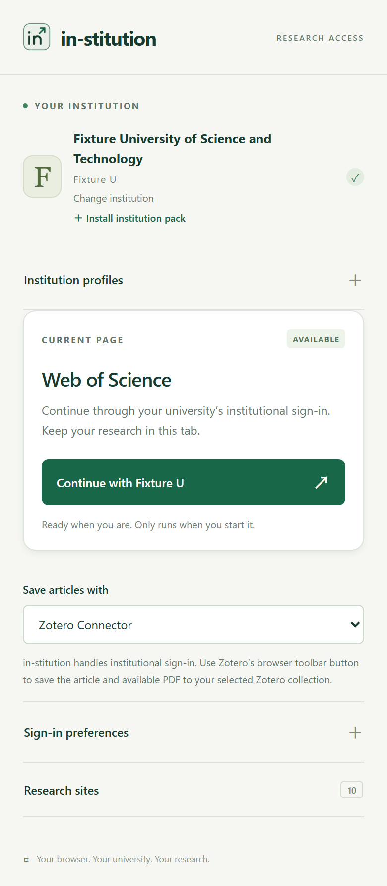

# in-stitution

A Chrome / Edge institutional sign-in companion for Zotero Connector, EndNote Click and other reference managers.

**Publishers and universities are separate integrations.** Shared provider adapters open institutional access and discovery. The selected institution library owns the university's actual authentication routes, account steps, and consent behavior.

**Release status: developer preview.** The core and institution packs are independent projects. Each institution maintainer owns its login implementation and verification. Start with [the setup guide](docs/getting-started.md) and [release assessment](docs/release-readiness.md).

## Install and use

Download the extension ZIP from [in-stitution releases](https://github.com/dumixthestpd/in-stitution/releases). Institution packs have their own releases; the first maintained pack is [sustech-in](https://github.com/dumixthestpd/sustech-in). Both are developer previews with manual updates.

For a fresh local setup, run `npm run package:setup` or use the prepared setup ZIP. Extract it, load its `in-stitution/` folder, then drag your institution’s `.instpack` into the extension. Disable an older installed copy while testing. The bundle contains no saved accounts or browser state.

To remove a saved institution, choose **Change institution → Remove institution**, or use its card in the institution pack manager.

1. Open chrome://extensions or edge://extensions, enable **Developer mode**, and choose **Load unpacked**.
2. Select this repository's extension/ directory, or extract the release ZIP and select that folder.
3. Open the extension, click **Install institution pack**, and drop your institution's `.instpack` archive onto the page.
4. Review its details, click **Install institution**, and approve its exact login sites. You can also configure a generic manual/CAS profile through **Change institution**.
5. Open a research page and click **Continue with your institution**.

Chrome 135+ is required. Enable **Allow User Scripts** in the extension's browser Details once for executable packs, then return to the installer. No npm installation or external authentication service is needed for browser use. Reload the extension and research tab after source edits.

A fresh core installation starts with **Choose your institution**. Install and configure an institution pack before starting. University code is distributed separately from the core. For an unlisted university, begin with **Discovery only · normal university login**; the extension assists supported discovery while you use the university's normal account and MFA flow. Zotero Connector or EndNote Click is installed separately. Browser-only use needs no Node.js or debugging port.

Packs carry the institution's own JavaScript adapter and supporting configuration files, with reviewed installation, updates, export and removal. New institution algorithms do not require a core rebuild. Imported code runs through the browser's User Scripts API on an active matching journey, and cannot read the extension credential vault. The pack supplies its own configuration screen and decides account handling, API work, MFA pauses and completion. Old settings-only JSON packs remain compatible. See [institution packs](docs/institution-packs.md) for the SDK and trust boundaries.

## Institution integrations

| Library | Purpose |
| --- | --- |
| Executable institution packs | Independently installed JavaScript and resources for the institution's own portal, protocol and account choices; no core registration. |
| Standard CAS + Shibboleth | Reusable protocol library for institutions using the standard CAS form; supports different login URLs and service paths. |
| Discovery only | Select your institution and use the university's normal login, password manager, and MFA. |

A profile contains common names and host grants. An executable pack supplies the actual institution algorithm and can keep additional protocol configuration in its own resources, rather than fitting the core CAS schema. Legacy profile JSON configures bundled libraries; executable source is installed as a complete `.instpack` archive.

See [the institution-library API](docs/institution-libraries.md) and [the example university library](examples/example-university.js). The example demonstrates a campus portal followed by OIDC, with normal account sign-in and MFA. It is fictional and is not an available university integration.

University implementations live in `extension/institutions/<institution-id>/`. Each independently versioned institution project has its own pack sources, tests and release artifacts. Keep each university's specific routes, defaults, migrations and live results in its own directory; shared helpers remain in `extension/institutions/`.

**Developers can distribute their own institution adapters.** Run `npm run institution:new -- --id my-u --name "My University" --origin https://login.example.edu` with verified values to create an independent source pack and tests. Build with `npm run institution:build -- extension/institutions/my-u/pack`. The core catalog and manifest are unchanged. Follow [CONTRIBUTING.md](CONTRIBUTING.md); each institution's maintainers own its implementation and live checks.

## Shared research providers

Adapters cover Web of Science / Clarivate, ScienceDirect / Scopus, Springer Nature / Nature, Wiley, IEEE Xplore, ACS, RSC, CNKI, Taylor & Francis, and JSTOR. CARSI and SeamlessAccess discovery are shared. The library subscription and publisher's current login UI determine actual availability.

## Profiles, preferences, and privacy

Use **Institution profiles** to create, edit, remove, import, or export configuration. No university preset is bundled in the standard core release. Up to 20 profiles can be saved. Imported JSON opens in the editor for review before activation. Exported profiles exclude credentials.

Credentials and automation preferences are separate per institution. Libraries that support credentials can optionally save them on this browser without extension-level encryption. **Submit university login** and **Continue attribute release** default off. Other libraries leave password entry and MFA to the university and browser. Forgetting credentials does not sign out existing sessions.

Enable **Start automatically on research sites** once to start on supported pages without opening the popup. With saved credentials and the other automation preferences enabled, the helper handles institution selection, continuation, university login, and supported attribute release. Stop pauses the current tab; a manual Start resumes it. First-time publisher agreements, MFA, and verification challenges can still require your action.

The background worker resolves supported sign-in routes directly across provider families, preserving publisher-created authentication state. Springer and Nature can retain a book/article return URL; other routes are restricted to verified entry pages. Compatible CARSI transactions skip university-list clicks. See the [routing matrix](docs/live-browser-checks.md). Enable **Use compatibility mode** to retain the full page sequence.

**Import local credentials file** accepts one `username:password` line or a JSON object with `username` / `password` (also `sid` / `pwd`). Choose the file once; its contents are parsed inside the browser and saved to that institution’s extension storage. The original file stays unchanged and is not watched. Import again after a password change. Profiles exported as JSON never include these credentials.

Each journey captures its institution profile at start; switching universities does not redirect an in-progress journey to the new university. Credentials are bound to both the profile and its authentication configuration. Changing authentication configuration clears stored credentials and preferences for that profile. Institution libraries own their legacy migrations. All university login origins require an exact optional grant; starting sign-in or enabling automatic start requests it when needed.

The extension has storage, activeTab, scripting and userScripts permissions. The optional HTTPS host declaration allows asking for exact custom institution origins at runtime; it does not grant automatic access to every site. Imported adapters require an explicit file install and the browser's User Scripts setting. The core has no analytics, cookie export, publisher scraping or download automation. User-installed code is trusted code on its approved pages; review its source and maintainer.

Shared publisher discovery is limited to ten minutes and thirty actions. API 2 institution packs take ownership on their login sites: they provide their own setup screens, decide their protocol and completion, and may use background APIs, page JavaScript and approved child frames. Their private configuration stays outside exported packs. Use **Configure institution** for pack-defined settings and **Stop** to cancel assistance. Browser permissions, verification challenges and institution rules still apply. See the [pack author guide](docs/institution-packs.md).

## Independent projects and developer guide

Read the [Institution Pack Developer Guide](docs/institution-pack-development.md) before building. Find an existing login stack or institutional resource first, then adapt and verify it. The framework and institution integrations have independent versions and release artifacts. Run `npm run release:projects` to prepare separate core and institution distributions; see [separate project releases](docs/releasing-projects.md).

## Development and validation

Development continues on `main`. Git tracks source and documentation; local browser profiles, credentials and build outputs are ignored. The public core repository starts from a clean institution-neutral source export. Earlier backups remain in the original development workspace.

Node.js 22 or later; no npm dependencies.

~~~sh
npm test                # Core, worker, profile isolation and release-boundary tests
npm run check          # Manifest, syntax, assets, provider and library loading
npm run test:browser   # Chromium fixtures, popup rendering, installed-extension check
npm run package        # Reproducible extension ZIP under dist/
~~~

Set BROWSER_PATH if the browser runner cannot find Chrome / Edge / Chromium. The runner needs a recent Chromium build supporting Extensions.loadUnpacked. In restricted containers it accepts --no-sandbox through npm run test:browser -- --no-sandbox. It uses an isolated profile under .browser-test/, intercepted fixture pages, and fake credentials.

Tests exercise discovery, another university's non-CAS flow, credential boundaries, consent, stop controls, shadow forms, localized fields, and the actual unpacked extension starting automatically. Fixture success does not certify every institution.

Live account checks and their limits belong to each independent institution project. Historical shared-checkout notes are linked from the [provider report](docs/live-browser-checks.md). Other institutions require independent live verification. Framework checks also reject institution-specific domains and behavior in shared runtime files.

## Agent search and reference managers

Run `node mcp/server.cjs` for public Crossref search, DOI lookup, and read-only search of your existing Zotero Desktop library through Zotero's local API. Zotero keeps the library and search index; in-stitution handles browser authentication. See [setup and limits](docs/agents.md).

This is an independent project. Upstream authentication attribution belongs in each institution project. There is no runtime dependency or automatic access to external credential files. See [CHANGELOG.md](CHANGELOG.md), [CONTRIBUTING.md](CONTRIBUTING.md), and [LICENSE](LICENSE).

## Reference managers

Choose **Save articles with** in the popup. After institutional access is available, use **Zotero Connector's toolbar button** or **EndNote Click's native viewer/export controls**. These tools retain their existing translators, citation metadata, attachment handling and destination selection. The preference changes guidance; it does not install, enable or remotely trigger another extension.

The separate article PDF panel was removed in v0.7.0; its backup remains in the original development workspace. Reload existing article tabs after upgrading. No capture or PDF automation is exposed. Any future agent-driven attachment retrieval must coordinate the requested minimum **30 seconds per article**; in-stitution cannot pace independent native saves. See [reference-manager setup and verification](docs/reference-managers.md).
